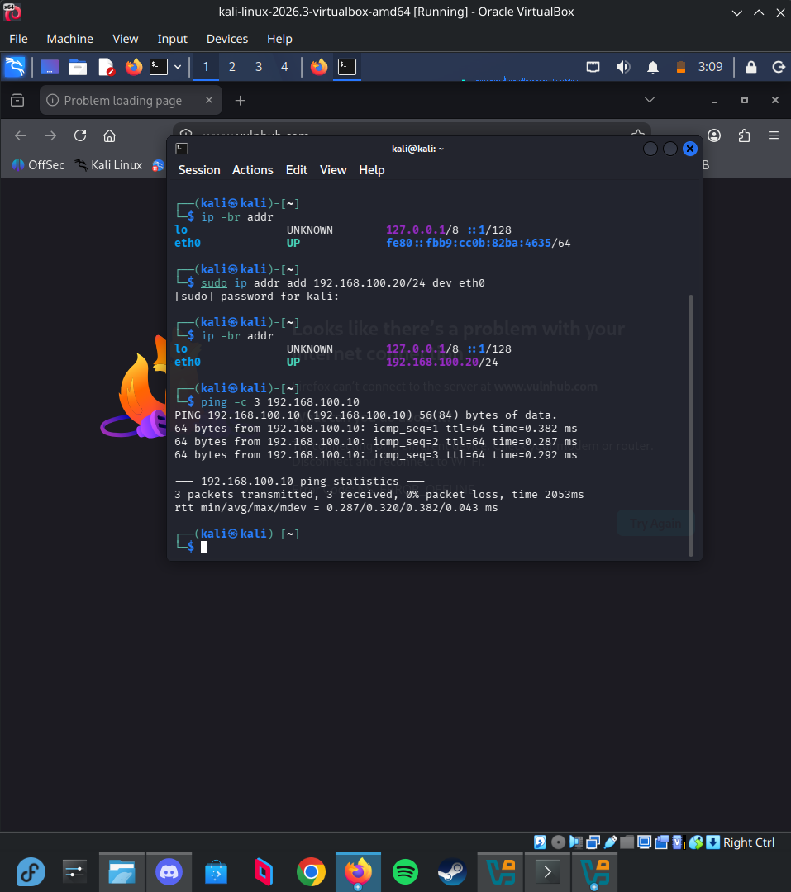
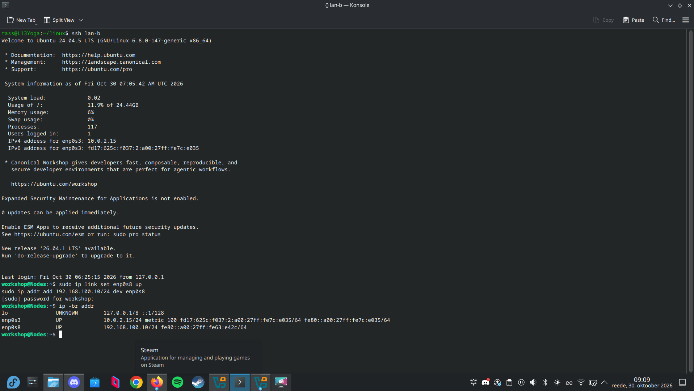
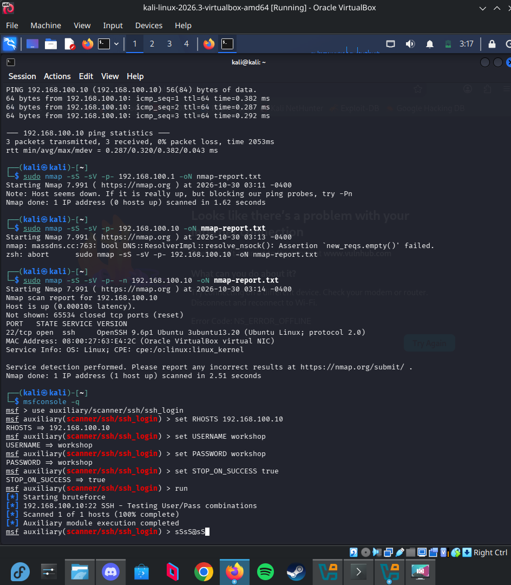
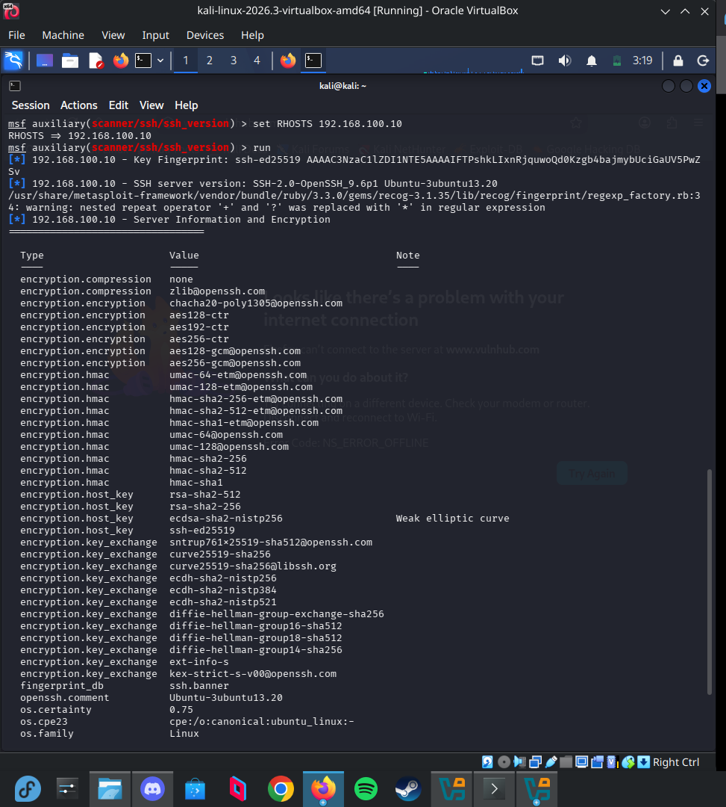

# Penetration Testing & Security Audit Report

## 1. Environment & Architecture
- **Attacker VM**: Kali Linux (`192.168.100.20/24`)[cite: 8]
- **Target Node**: Hardened Ubuntu VM (`192.168.100.10/24`)[cite: 6, 9]
- **Network Mode**: Isolated VirtualBox Internal Network segment (`lab-net`)
- **Execution Constraint**: Kali environment was executed as-is without running `apt update` or `apt upgrade` per lab guidelines[cite: 4].

---

## 2. Network Reconnaissance (Nmap Port Scan)
Full TCP port audit executed across all 65,535 ports:

    sudo nmap -sS -sV -p- -n 192.168.100.10

### Findings
- **Closed Ports**: `65534 closed tcp ports (reset)`[cite: 13]
- **Exposed Services**: Only `22/tcp open ssh OpenSSH 9.6p1 Ubuntu 3ubuntu13.20 (protocol 2.0)`[cite: 13]
- **Hardening Verification**: All non-essential services removed during the hardening phase (vsftpd/21, telnetd/23, smbd/139/445, cupsd/631) were confirmed absent and closed over the network interface.

---

## 3. Security Audit & Service Inspection (Metasploit)

### A. Credential Stuffing & Authentication Audit
- **Module**: `auxiliary/scanner/ssh/ssh_login`[cite: 15]
- **Target**: `192.168.100.10:22`[cite: 15]
- **Tested Credentials**: `workshop:workshop`[cite: 15]
- **Result**: Authentication rejected with zero sessions created[cite: 15]. The SSH daemon strictly enforces public key authentication and refuses password auth on the wire (`PasswordAuthentication no`).

### B. Service Information & Cipher Audit
- **Module**: `auxiliary/scanner/ssh/ssh_version`
- **Target**: `192.168.100.10:22`[cite: 17]
- **Key Exchange & Encryption**: Modern Curve25519 (`curve25519-sha256`) and post-quantum hybrid (`sntrup761x25519-sha512@openssh.com`) algorithms verified[cite: 16, 17].
- **Host Key**: Validated `ssh-ed25519` key fingerprint[cite: 17].

---

## 4. Conclusion
The defensive controls implemented on the target host successfully minimized its attack surface. Automated scans and security auditing modules confirmed that unnecessary listening services are completely eliminated and remote unauthorized access is prevented via strict public-key authentication.
