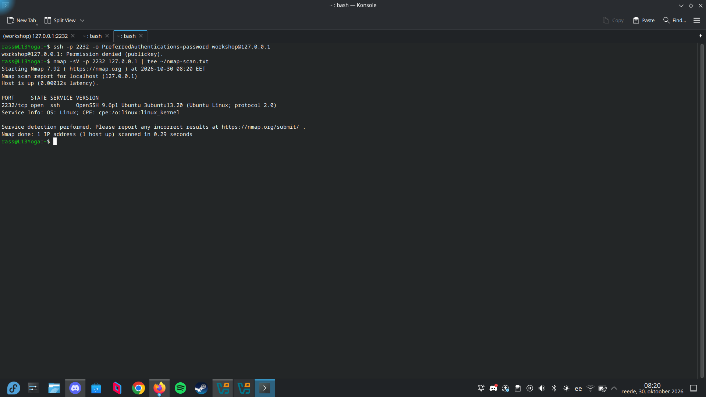
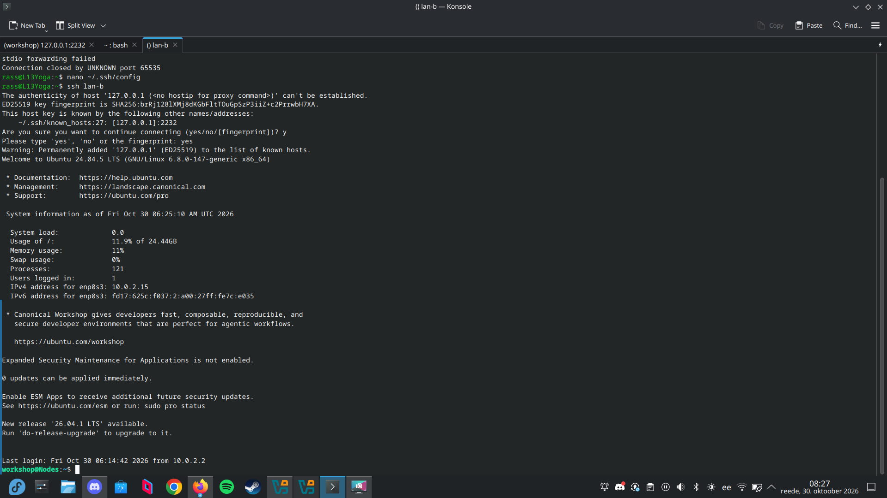

# Lab: Host Hardening, SSH Security & Patching

## 1. Attack Surface Minimisation (Lab 9.A)

I dumped the initial bloated system state into `before.txt`, stripped out the unnecessary services and packages, purged the extra test accounts, and then recorded the cleaned-up state in `after.txt`.

- Pre-hardening baseline: [`before.txt`]
- Post-hardening baseline: [`after.txt`]
- Full diff: [`diff.txt`]



```diff
--- ~/before.txt
+++ ~/after.txt
@@ -1,15 +1,2 @@
-LISTEN 0 128 0.0.0.0:21 (vsftpd)
-LISTEN 0 128 0.0.0.0:23 (telnetd)
-LISTEN 0 50 0.0.0.0:139 (smbd)
-LISTEN 0 50 0.0.0.0:445 (smbd)
-LISTEN 0 128 0.0.0.0:631 (cupsd)
-LISTEN 0 4096 *:5353 (avahi-daemon)
 LISTEN 0 4096 0.0.0.0:22 (sshd)
-dpkg total: 1140 packages
+dpkg total: 980 packages
